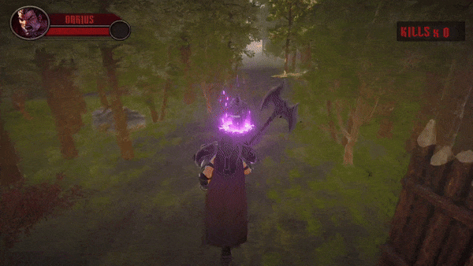
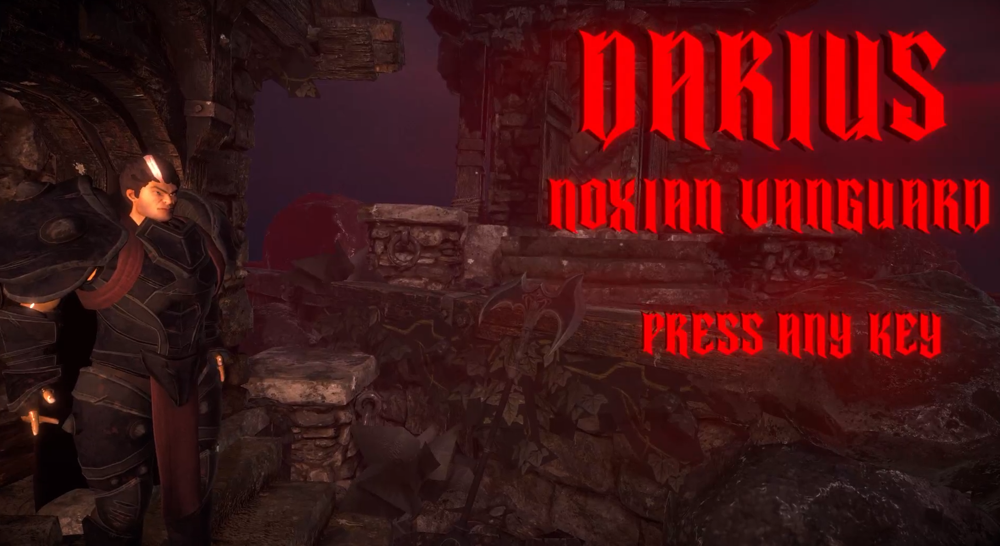

# ⚔️ Darius: Noxian Vanguard

A 3D hack-and-slash game developed with Unity, featuring an epic battle between Darius and Garen.

This project showcases my work in 3D game development, combat gameplay, and creating immersive environments.

## 🎮 Play the Game

**Play on itch.io:**  
👉 https://thodoristolis.itch.io/dariusnoxianvanguard

## 📸 Gameplay Showcase

### ⚔️ Combat Gameplay

### 🏰 Main Menu

### 🌍 Game World

## 🎯 About the Project

Darius: Noxian Vanguard is a 3D action game inspired by the confrontation between Darius and Garen from League of Legends.

The project focuses on delivering a combat-oriented gameplay experience within a 3D environment.

## ✨ Highlights

- ⚔️ 3D hack-and-slash gameplay.
- 🛡️ A battle featuring Darius and Garen.
- 🌍 An atmospheric 3D game world.
- 🎮 A standalone game experience.
- 🕹️ Developed using Unity.

## 🛠️ Technologies Used

| Technology | Purpose |
|------------|---------|
| Unity | Game engine |
| C# | Gameplay programming |

## 🚀 What I Learned

Through this project, I gained experience in:

- Developing a 3D game using Unity.
- Building an interactive gameplay experience.
- Working on combat-focused game mechanics.
- Creating and presenting a complete game project.

## 👨‍💻 Developer

**Theodoros Tolis**

Game Developer | Unity | 3D Game Development

- 🎮 **Game:** https://thodoristolis.itch.io/dariusnoxianvanguard

---

*Developed as a game development project by Theodoros Tolis.*
